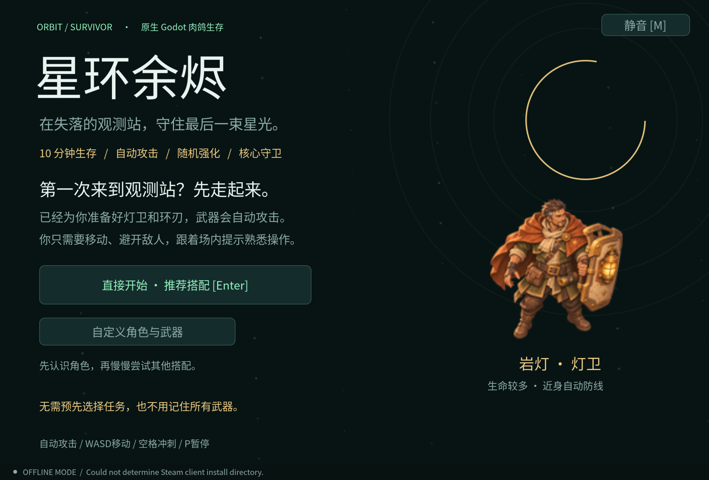

# 星环余烬 · Orbit Survivor

最新：六人已接四帧迈步；升级加入六种三级模块、四模块槽和每局一次 R 重抽。1:30 起可选设施，靠近按住 E 选定，留在圈内完成；三处最多选两处，影响本局炮塔、经验回收与治疗补给。Tab 查看构筑及设施距离。[实现与验证](docs/RUNTIME_UPDATE.md) · [走路预览](output/imagegen/characters-v005/index.html)。

配件更新：八配件与三次随行维护已可玩。2:00 / 4:30 / 7:00 出现维修架，靠近按 E，选择配件后确认；Tab 查看装备。取消不消耗，领取配件或维修包后该架失效。

当前可玩更新：Godot 已接入六人选择与透明战斗小图、角色战斗被动、第四武器锚灯炮台、伤害数字和暴击反馈。双击 `play.command` 启动；六人均开放试玩，未做正式角色解锁门槛。详见 [本轮实现与验证](docs/RUNTIME_UPDATE.md)。

当前更新：六名角色的概念/头像/单朝向透明战斗小图已接入网页，新增刺客墨刃；64/96px、灰度与武器搭配见 [v004 六人预览](output/imagegen/characters-v004/index.html)。[战斗挂点与配件路线](docs/CHARACTER_LOADOUTS.md) · [刺客机制](docs/ASSASSIN_DESIGN.md)。历史 v001–v003 记录保留；Godot 六人机制、分层换装、多朝向动画仍待实现。


一个可在本地玩的 Godot 2D 肉鸽生存原型。移动、自动战斗、拾取经验、随机三选一升级，撑过十分钟并击败核心守卫。支持离线游戏，保留 GodotSteam 连接检测。

后续开发使用 v0.5 单机设计基线：

- [五人角色统一画风](output/imagegen/characters-v003/index.html) / [v003 提示词](art/prompts/characters/v003/README.md)：原三位重做概念与同源头像，选择页已更新；v004 已补齐静态战斗稿，动画待制作。
- [武器升级与配件设计](docs/WEAPON_CUSTOMIZATION.md)：每武器一个配件槽、八件有收益与代价的配件、局内维护、进化兼容；尚未接入游戏。
- [首批武器与怪物概念图](output/imagegen/combat-v002/index.html) / [留存提示词](art/prompts/combat/v002/README.md)：星辉弹、环刃、追击者、疾行者，含原图和评审；不是完成的战斗动画。
- [战斗专项设计](docs/COMBAT_DESIGN.md) / [战斗美术与特效规格](docs/COMBAT_ASSET_BRIEF.md)：武器手感、怪物状态机、技能时序、统一伤害/暴击、数字与音效；初测参数尚未接入游戏。
- [头像与透明战斗首帧](output/imagegen/characters-v002/index.html) / [v002 提示词与资产记录](art/prompts/characters/v002/README.md)：两位角色的同源头像、静态小人及 64/96px 检查；已接入网页预览，未制作动画。
- [真实生图与对照预览](output/imagegen/characters-v001/index.html) / [留存提示词](art/prompts/characters/v001/README.md)：霁月与螺灯的 v001 绘画风概念图，含原图与执行记录。
- [角色设计](docs/CHARACTER_DESIGN.md)：新增女性星图师、机器人螺灯，包含外形、性格、被动与美术制作要求；[造型对照板](artifacts/ui/characters/index.html) 可查看当前 SVG 结构稿。
- [游戏设计案](docs/GAME_DESIGN.md)：角色、武器、模块、场景、敌人、Boss、初始数值与成长规则。
- [实施与验收计划](docs/IMPLEMENTATION_PLAN.md)：M0–M6 的依赖、任务、验收条件与主要风险。
- [界面与视觉规范](DESIGN.md)：UI、交互、可读性、平台约束与视觉语言。
- [界面页面设计](docs/UI_DESIGN.md) / [可点击视觉原型](artifacts/ui/index.html)：七个核心页面、辅助弹层与示例截图；不是正式游戏实现。

设计基线中的新角色、进化和场景装置属于待实现内容；下文描述当前可玩的原型。规划的单局目标为约十分钟，Boss 击败即结束；当前原型仍使用原有计时与胜负规则。



## 直接玩

双击项目里的 **`play.command`**，或：

```bash
./play.command
```

在菜单选择任意初始武器即可开始。无需 Steam 账号也能完整离线玩。

| 操作 | 按键 |
|---|---|
| 移动 | WASD / 方向键 |
| 冲刺 | 空格，3 秒冷却，冲刺期间无敌 |
| 选择强化 | 鼠标点击 / 数字 1、2、3 |
| 暂停 / 继续 | P / Esc |
| 静音切换 | M / 右上角按钮 |
| 结算后重开 | R / 按钮 |

暂停菜单可以放弃本局回营地；放弃或直接关窗口不发放本局奖励。

## 已实现的游戏循环

- **三种武器**：星辉弹自动索敌；环刃近身切割；引力新星范围伤害并击退。可同时携带，每种最多六级。
- **四种普通敌人**：追击者、疾行者、重甲单位、远程术士。敌人数量、组合和生命随时间提升。
- **随机升级**：经验达到门槛时暂停战斗，提供三个不同选项。可升级武器、攻击力、攻速、移速、拾取范围、生命或护甲。
- **终局 Boss**：9:00 出现核心守卫，释放环形弹幕；存活到 10:00 且击败 Boss 才获胜。如果十分钟时 Boss 仍存活，可继续战斗。
- **局外成长**：死亡或胜利后获得星砂，可在营地购买永久核心等级；每级生命 +8、伤害 +4%。
- **完整 UI**：中文主菜单、初始武器选择、HUD、生命/经验条、敌人雷达、升级卡、暂停、结算。
- **反馈**：敌人受击闪烁、死亡粒子、冲刺残影、范围冲击、程序生成音效。无外部图片或音乐依赖。

这仍是可玩的原型，包含一个场地和一个 Boss；没有联机、创意工坊、云存档、Steam 成就或美术资源包。难度只做了基础模拟校验，未经过大量真人平衡测试。

## 存档

局外星砂、核心等级、最佳生存时间、最高击败数量和总局数保存在 Godot 的：

```
user://orbit_survivor_profile.cfg
```

macOS 通常位于：

```
~/Library/Application Support/Godot/app_userdata/星环余烬 · Orbit Survivor/
```

写入使用临时文件再重命名；写入失败会显示提示并回滚购买/奖励。不会读写原来 Orbit Collector 的用户数据。

## 本地工具与 Steam

GodotSteam 编辑器已解压在 `.tools/`，不修改系统应用目录。首次安装或换一台 Mac：

```bash
bash scripts/setup-macos.sh
./play.command
```

脚本固定使用官方 **GodotSteam 4.23.2 / Godot 4.7.2** macOS 包，并核对 GitHub 发布的 SHA-256。

```bash
./play.command --editor              # 打开编辑器
./play.command -- --offline          # 不尝试连接 Steam
GODOT_BIN=/absolute/path/to/godot ./play.command
```

Steam 接入位于 `scripts/steam_bridge.gd`，使用共享测试 App ID **480**，初始化成功显示昵称，否则自动离线。普通 Godot 没有 Steam 单例也能玩。

正式发行前要换成自己的 App ID。本机未安装 Steam，尚未验证在线昵称、Overlay 等功能。

## Windows + macOS

游戏场景、战斗、输入和存档代码共用；系统字体分别尝试苹方、微软雅黑和 Noto，缺少时回退。

本项目使用 **GodotSteam 预编译编辑器**，导出必须使用与其匹配的 **GodotSteam 导出模板**；不要混用标准模板，也不要同时装 GDExtension。

1. 从固定版本发行页下载 Godot 4.7.2 对应模板。
2. 在 Project → Export 添加 Windows Desktop / macOS，配置对应的自定义模板。
3. 携带所需的 Steam API 动态库；macOS 发行处理签名、公证与目标架构。
4. 分别在 Windows/macOS 实机验证，再上传到同一 Steam 应用的不同平台 depot。

当前本地验证覆盖 macOS。**尚未生成发行包或在 Windows 上运行**。

## 代码结构

- `scripts/run.gd`：战斗、武器、敌人、经验、升级、胜负；不依赖场景绘制。
- `scripts/game.gd`：菜单、输入、镜头、世界绘制、HUD 和结算。
- `scripts/profile.gd`：进度校验、原子写入、星砂与永久强化。
- `scripts/sound.gd`：本地合成音效与静音。
- `scripts/steam_bridge.gd`：Steam 初始化与回调、离线回退。

## 验证

```bash
./play.command --headless --editor --import --quit
./play.command --headless --script res://tests/smoke.gd -- --offline --test
./play.command --headless --script res://tests/profile_test.gd -- --offline --test
./play.command --headless --script res://tests/balance.gd -- --offline --test
./play.command --script res://tests/visual_smoke.gd -- --offline --test
```

测试使用固定随机种子及独立临时存档，不修改正常玩家进度。`--test` 是测试隔离开关，不是正常游戏的无敌开关。

战斗测试覆盖武器、碰撞、伤害保护、冲刺、升级暂停、经验溢出、Boss 弹幕和胜负；另有十分钟加速模拟。存档测试覆盖持久化、非法值和失败回滚。图形测试覆盖实际渲染、键盘输入、按钮信号、暂停、结算只发奖一次，生成菜单、战斗、升级、Boss、暂停和结算截图。

图形测试中的中局与胜利画面使用可复现的测试状态，十分钟压力模拟也会设置测试专用无敌；它们证明流程可以运行，不代表真人通关或证明难度平衡。`balance.gd` 则以正常生命与伤害进行三个初始武器的走位模拟。

详细结果见 [artifacts/VALIDATION.md](artifacts/VALIDATION.md)。

## GitHub 参考

- [GodotSteam/GodotSteam](https://github.com/GodotSteam/GodotSteam)：官方 Steamworks 集成，主要开发已迁到 Codeberg。
- [GodotSteam/Skillet](https://github.com/GodotSteam/Skillet)：官方游戏示例，部分源码公开，已迁至 [Codeberg](https://codeberg.org/godotsteam/skillet)。
- [Malcolm-Q/SteamGodotTemplate](https://github.com/Malcolm-Q/SteamGodotTemplate)：菜单、LAN/Steam 房间和好友邀请；README 标注 Godot 4.4，未作为本例依赖。
- [Finnder/GodotSteamPTPTemplate](https://github.com/Finnder/GodotSteamPTPTemplate)：P2P、本地多人和单机模式组织，未在本机运行。

游戏代码为本地新写，没有复制社区模板或第三方游戏素材。

[官方入门](https://godotsteam.com/getting_started/introduction/) · [初始化](https://godotsteam.com/tutorials/initializing/) · [导出](https://godotsteam.com/tutorials/exporting_shipping/) · [固定版本工具](https://github.com/GodotSteam/GodotSteam/releases/tag/v4.23.2)
