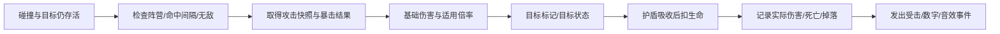

# 《星环余烬》战斗专项设计 v0.1

状态：设计基线与初测参数，不是已接入的游戏功能，不宣称完成平衡。当前代码仍是原型战斗，尤其没有本文件规定的暴击、精英状态机与表现管线。

本文件拥有武器命中、怪物行为、伤害/暴击和战斗反馈规则；[资产制作规格](COMBAT_ASSET_BRIEF.md)拥有相应美术/动画交付要求。可计算的初测参数见 [combat-v001.json](data/combat-v001.json)，与旧版 GDD 参数相同的部分沿用，新增/细化规则以本文件为准。

## 1. 设计目的与首版范围

让玩家通过攻击形状、节奏、音色和敌人预警，理解“为什么打中、为什么暴击、为什么受伤”，而不是靠粒子数量或大数字制造反馈。

首版维持五角色、四武器及四进化、六模块，新增八种局部配件（每武器一槽，见 [武器定制](WEAPON_CUSTOMIZATION.md)），以及四普通怪、两精英、一个三阶段 Boss；霜冻、燃烧、吸血、闪避、元素抗性与额外主动技能不同时加入。所有战斗美术与已认可的角色统一为温暖的绘画风奇幻天文机械遗迹。

## 2. 四种武器的独立身份

| 武器 / ID | 物件外形 | 战斗职责 | 节奏与声音 | 弱点 |
|---|---|---|---|---|
| 星辉弹 / pulse | 青铜聚光器，中心一枚蓝白星核，短而清晰的发射轴 | 稳定点杀与穿透；对应精准流 | 有间隔的短点射，清脆但不尖锐的“嗒—叮” | 攻击线窄，面对包围要依赖走位或副武器 |
| 环刃 / orbit | 两枚弯曲的新月铜刃，刃尖像彗星尾，不是厚重实体圆盘 | 近身开路与持续范围清理 | 周期掠过，轻金属风声；命中才补短切割声 | 必须靠近；数量增加不等于无限叠单体伤害 |
| 引力新星 / nova | 一枚悬浮的刻度引力环，核心短暂收束再张开 | 击退解围、范围爆发 | 稀疏而有重量的“蓄—砰”，留出静默间隔 | 冷却长；爆发结束后有危险空窗 |
| 锚灯炮台 / turret | 非人形三足灯架，上部聚光枪口，与机器人角色明显区分 | 建立局部火力区，鼓励引怪与换位 | 部署一次“咔哒”，稳定低音点射 | 玩家离开射程后价值下降；同时最多两座 |

角色仍共用武器规则。最多一件“手持/近身挂载”武器完整显示，其余以环绕、施法或地面单位表现，不给角色同时挂三套大枪遮住身体。

### 2.1 星辉弹

- 自动寻找 700 范围内可见/近屏幕最近敌人，距离相同按稳定实体 ID；不默认强制攻击远处标记目标，玩家通过站位决定先打谁。
- 六级参数沿用 GDD。多发弹定义为**一次攻击内的短点射**，每发间隔 0.04 秒，替代原型容易打空的宽扇形。冷却从第一发开始，下一轮不能插入未完成的上一轮。
- 同一轮目标存活时继续指向该目标；目标死亡/失效时下一发重新索敌。本轮第一发发射时快照武器、模块、配件、角色和核心等施放者参数，整轮各发与在途弹不因中途升级/换装改变；目标标记状态在命中时查询。
- 弹速 590；飞行距离到 700 或命中预算耗尽即回收。穿透次数为首个目标以外可再击中的目标数。
- 快速弹体使用运动线段与圆形受击区域的连续检测；沿本帧路径排序命中目标，不能按数组顺序打到后方敌人。每个弹体记录已命中的目标。

### 2.2 环刃

- 初始两刃、最高五刃，半径 80→105，角速度基准 2.7 弧度/秒。
- **普通环刃对同一目标共享 0.25 秒命中间隔**，不能把五刃重叠算成五次瞬间伤害。
- 稳定轴对于环刃改为提升旋转速度：角速度除以 `(1 - 模块等级×4%)`；共享命中间隔仍为 0.25 秒，不能同时再缩短该间隔。
- 使用刀刃本帧的圆弧扫掠判断，避免低帧率只检查最终点导致穿过敌人不结算。

### 2.3 引力新星

- 施放时锁定地面中心；0.12 秒轻蓄力与扩张后进行一次范围结算，角色可以继续移动。
- 结算时范围内每个目标只受伤一次；随后进入的目标不会受到已经结束的脉冲伤害。
- 普通怪被击退 35，精英受一半，Boss 不位移；不能把视觉环当成持续伤害区域。
- 每次施放统一决定是否暴击，但角色标记/目标状态仍按各目标独立计算。

### 2.4 锚灯炮台

- 基础部署与射击参数沿用 GDD，部署后不主动跟人跑；玩家需要绕回火力区。
- 炮台弹体继承拥有者的模块、核心、暴击率与适用角色倍率；不继承巡迹者“每第四次自身射击穿透”的计数。
- 替换最旧炮台只退场，不触发击杀、爆炸、治疗或经验，不能通过攻速刷部署收益。
- 地图设施炮塔另属 `world`，不继承角色/模块/暴击，不混用武器炮台预算。

## 3. 进化：改变攻击行为，而非只放大贴图

| 进化 | 行为变化 | 约束 | 表现变化 |
|---|---|---|---|
| 折光星雨 | 原弹第一次有效命中后分成两枚碎弹，基础伤害各为原弹的 35% | 每枚原弹最多分裂一次；碎弹不再分裂/穿透，继承原弹暴击结果，不复制已结算的最终伤害 | 直线轨迹分成两个短弧；碎弹细小，避免每颗都爆大光 |
| 双层星环 | 内外两圈反向旋转，各有自身对目标的 0.35 秒命中间隔 | 圈内多刃共享间隔；不能逐刃各开一个计时器 | 两条断续细轨迹、不同半径；中央保持可见 |
| 坍缩之井 | 0.45 秒牵引普通怪，之后一次 150 基础伤害爆发 | 精英牵引减半；Boss 不位移，最多减速 20% 一秒；没有额外隐藏持续伤害 | 收束星尘→边界收紧→短爆发→快速消散 |
| 巡航灯塔 | 一座固定炮台＋一座缓慢跟随的灯塔，总数仍两座 | 灯塔重复部署只刷新持续时间，不复制第三座；移动速度 120 | 固定三足与悬浮短翼区分；不长成第二个玩家机器人 |

碎弹排除触发分裂的那个目标，优先指向原命中点附近两个不同敌人；只有一个新目标时最多派一枚，另一枚沿分叉方向飞行。原弹穿透后的后续命中不再触发分裂。此规则防止原地分裂回撞形成隐形数倍单体爆发。

## 4. 伤害系统

### 4.1 结算过程



伤害计算是权威，飘字和特效只是观察者。关掉数字、粒子池满或音效静音，都不能改变伤害、暴击随机数或掉落。

### 4.2 玩家武器统一公式

```
D = B × K × M_part × (1 + A) × M_role × M_core × M_supply × M_mark × M_crit × M_target
```

| 项 | 含义 |
|---|---|
| B | 当前等级基础伤害；例如六级星辉弹 42 |
| K | 本次事件比例；原弹 1，星雨碎弹 0.35 |
| M_part | 单武器配件伤害倍率；无配件为 1；配件与进化兼容见 [武器定制](WEAPON_CUSTOMIZATION.md) |
| A | 适用的模块伤害加成之和；不把无关模块强加给所有武器 |
| M_role | 角色适用倍率：灯卫范围/环绕 1.15、飞行投射物 0.9；织星匠炮台 1.2；不适用为 1 |
| M_core | `1 + 核心等级×2%`，最多五级 |
| M_supply | `1 + 本局火力补给次数×1%` |
| M_mark | 霁月自己的命中目标处于星痕时 1.25，否则 1；地图炮塔不获得此项 |
| M_crit | 暴击 1.5，否则 1 |
| M_target | 目标承伤倍率，首版普通怪/精英/Boss 都为 1，不额外藏元素抗性或护甲 |

同一事件带 `orbit` 与 `area` 标签时，灯卫的 1.15 只应用一次。机器人治疗折扣属于回复流程，不进入攻击伤害公式。

例：霁月使用六级星辉弹、聚光镜三级（适用投射物伤害 +24%）、核心五级，命中标记目标且暴击：

```
42 × 1 × 1 × 1.24 × 1 × 1.10 × 1 × 1.25 × 1.50 × 1 = 107.415
```

内部保留浮点生命与伤害，只在飘字展示时用四舍五入（0.5 向上）显示 **107**。不在每个乘法步骤取整，也不让显示值反过来扣血。

### 4.3 玩家受伤、护盾与治疗

- 普通敌人伤害、敌弹和地面危险采用明确固定值，**不会随机暴击玩家**。
- 先检查冲刺免伤和 0.65 秒受击保护，只有有效命中才扣护盾/生命和重置螺灯自检。
- 护盾先吸收，余量扣生命。例如 20 护盾受到 22 伤害：护盾变零、生命减少 2，计为一次有效命中。
- 玩家统计分别记录“护盾承伤”和“生命承伤”；不能因为没掉生命就声称完全未受击。
- 治疗不暴击、不复活、不把超额生命变护盾。螺灯治疗量乘 0.75，开局满血和最大生命增量不打折。
- 同一攻击事件的冲撞/接触描述重叠时合并为一次有效事件，使用该攻击明确的招式伤害；不同来源按模拟步内命中时间排序，时间相同按稳定攻击 ID，不随机排列。
- 同帧死亡优先判负；敌人从活到死只登记一次，击败数、碎片和经验不能重复发放。

## 5. 暴击专项规则

### 5.1 数值与来源

- 玩家基础暴击率 **5%**，暴击伤害 **150%**。
- 星辉弹本身额外 **5 个百分点**，所以初始实际暴击率为 **10%**；其他三武器初始为 5%。
- 聚光镜每级额外 **3 个百分点全局暴击率**，保留原有投射物伤害 +8%/级。三级时全局 14%、星辉弹实际 19%。不新增第七个模块。
- 单次攻击最终暴击率上限 **35%**；首版没有超暴击、暴击叠层或可成长的暴击倍率。
- 霁月的标记增伤不等于暴击；正常标记命中仍是普通伤害，可另行随机暴击。
- 首版不做爆头、背击、护甲穿透或“看见弱点却判定不明”的额外系统。

墨刃突袭窗口：有效冲刺结束后 1.2 秒，自身直接武器攻击额外 +20 个百分点。最终暴击率 = min(35%, 基础 + 全局模块 + 武器局部 + 符合资格的突袭加成)。武器炮台和地图炮塔均不享受突袭；环刃在有效命中判定资格，远程在点射开始时快照窗口资格，派生弹继承。暂停冻结窗口，死亡/重开清除；无叠层、无额外无敌。详见 [刺客设计](ASSASSIN_DESIGN.md)。

### 5.2 每种攻击如何判定

| 来源 | 暴击随机单位 | 多段与继承 |
|---|---|---|
| 星辉弹 | 每枚原弹一个结果 | 点射中的各发独立；穿透命中的目标沿用这枚弹的结果 |
| 环刃 | 对目标每次通过共享命中间隔的有效命中 | 不是每帧/每刀刃尝试都掷骰 |
| 新星/坍缩 | 一次施放一个结果 | 同轮范围目标共享暴击，但各自标记状态不同 |
| 武器炮台/移动灯塔 | 每枚炮台弹一个结果 | 继承拥有者暴击参数，不继承其他武器的局部加成 |
| 星雨碎弹 | 不重新掷骰 | 沿用原弹暴击标记；以 `B×0.35` 重新走适用倍率，不能对原弹最终伤害再乘一遍 |
| 地图炮塔/敌方/治疗 | 不暴击 | 不出现黄色暴击数字和“暴击”音效 |

攻击本身发射/施放时确定暴击；环刃在命中资格确认后确定。穿透与分裂不能通过不同目标或多帧重复计算暴击。纯粹无敌、无效目标与被间隔过滤的接触不消耗环刃的暴击随机数。

暴击使用局内独立随机流；生成、升级、掉落与表现不共用它。首版采用明确概率，不额外加入未公开的保底或连续失败补偿。

## 6. 怪物：外形、职责与可反制动作

| 怪物 | 独立轮廓与识别点 | 行为状态 | 玩家应对 |
|---|---|---|---|
| 苔影追击者 | 低矮孢壳、短足、破裂星光从壳缝泄出；非人形兜帽 | 出现→追击→接触→受击/死亡；移动前后轻微重心摆动 | 学会绕圈、拾取和穿过空隙 |
| 裂隙疾行者 | 低伏长身、向后两根裂晶鳍、长尾；与圆形追击者区分 | 接近→停下 0.8 秒锁方向→直线冲刺 0.45 秒→恢复，至少三秒后再冲 | 横向移开，不能冲刺中继续转向追踪玩家 |
| 铜壳守卫 | 角形重甲、宽足、裂开的铜板与竖向红色镜隙；不复用友方机器人圆壳 | 缓慢逼近→近身压迫；受击可短停但不被无限推离 | 换路线、集中火力；高生命但没有隐藏减伤 |
| 镜眼术士 | 悬浮破镜、三片尖长支架、单一发射镜眼，明显非人形 | 接近约 300→0.7 秒预警→定向发射→恢复；太近时后退 | 看见发射方向后横移，优先处理远程压力 |

普通怪生命、速度、半径和伤害沿用参数 JSON。生命在生成时按 `1 + 0.08×floor(游戏秒数/60)` 快照；已经在场的敌人不在整分钟凭空回血。伤害、弹速与预警时间不随时间无限增大。

术士的 2.6 秒攻击周期包括 0.7 秒预警，不是额外再等待 0.7 秒；预警开始时锁定方向，不能在弹体出现前最后一帧突然改向。疾行者的冲刺冷却从冲刺结束开始。

### 6.1 两类精英

| 精英 | 时间 / 生命初测 | 招式 | 反制与奖励 |
|---|---|---|---|
| 三扇监守 | 3:00 / 1200 | 铜壳变体，三段扇形危险地面同时预警 0.9 秒；生效 0.25 秒；然后至少 1.8 秒恢复 | 三扇之间保留连续安全走廊；掉一枚唯一碎片和 15 经验 |
| 裂镜司仪 | 6:00 / 2200 | 镜眼变体，0.8 秒预警后发中间与两侧慢弹，速度 150；之后 2.2 秒恢复 | 先避开中线再沿弹隙移动；掉第二枚唯一碎片和 15 经验 |

精英为固定时间的一次性任务单位，生命不再乘普通怪时间成长公式；每个精英每种命中只造成一次伤害，不叠接触和招式伤害。最多两只存活，未击败不会重复生成新一轮。

### 6.2 Boss 招式时间轴

Boss 基础生命 12000，不叠普通怪成长；阶段界线 60%/30%。首轮单独演示弹环，阶段变化先结束当前攻击再切换，不在同一帧叠放两阶段攻击。

| 招式 | 预警 | 有效攻击 | 恢复 | 伤害 |
|---|---|---|---|---:|
| 缺口弹环 | 0.8 秒，标出固定安全扇区 | 两轮各 10 发慢弹，间隔 0.65 秒，留至少 50° 连续缺口；弹速 145 | 至少 1.6 秒 | 18/有效命中 |
| 锁向冲撞 | 1.0 秒，画出起点与走廊；锁方向 | 速度 400，持续 0.6 秒；不能横向追踪修正 | 1.8 秒 | 22 |
| 扫描束 | 1.0 秒显示完整走廊 | 持续 0.8 秒，最多旋转 20°；边界始终可见 | 2.0 秒 | 18；受击保护仍生效 |

阶段一只用弹环；阶段二弹环与冲撞交替；阶段三把扫描束加入轮换。首版不同时发扫描束和冲撞。冲撞后的两个余波区各预警 0.8 秒、生效 0.3 秒，伤害 12；它们也受同一玩家受击保护约束。

出场/转阶段不强行吸玩家、不从玩家脚下生成，也不以整屏白闪遮住现有弹体。危急时玩家应能看懂自己需要去哪里。

## 7. 波次、掉落与难度

生成阶段、权重和速度见 JSON，普通怪上限 140、精英两只、Boss 一只，总敌人最多 143。9:00 后普通生成速率从 7.5 降为 3.75/秒，10:00 停止普通生成。

- 时间段连续，不存在空窗/重叠刷怪段；配比权重每行总计 100。
- 达上限时不累计无限欠账；积压生成预算最多保留两秒，避免清掉一批后瞬间补几十只。
- 敌人从有效视野外或明确预警区出现，距离玩家至少 280；无合法位置时推迟，不能退化为近身偷袭。
- 疾行者于 0:30、铜壳于 1:30、术士于 2:15 后进入普通池。设施守卫可按事先显示的固定组合出现，不按普通池解锁时间偷偷变更。
- 经验实体满时合并经验值，不删除价值；精英碎片独立于经验池，不消失。
- 普通治疗包初测：1.5% 击败掉落概率，全局 20 秒生成冷却；恢复 15 生命。与温室产出分开统计，防止高刷怪量产生无限回血。无效冷却内不掷骰，不追加隐藏保底。

## 8. 技能特效与打击感

所有时间均为表现初测值，命中时刻必须与模拟结算事件一致。

| 特效 | 形状/颜色 | 出现与消散 | 信息重点 |
|---|---|---|---|
| 星辉弹 | 金白短核＋一段细尾迹 | 枪口 0.04 秒；尾迹约 0.08 秒；命中星点 0.08 秒 | 看得见方向，不把每发画成激光柱 |
| 环刃 | 暖铜新月＋短弧残影 | 常驻刀刃，残影不超过 0.10 秒 | 看清半径和真正刀刃，轨迹内部透明 |
| 新星 | 薄紫金细环，中央低透明 | 0.12 秒蓄/扩张，命中后约 0.25 秒消散 | 暴击只加强边缘一次，不把整个圆涂满 |
| 炮台 | 金属部署小尘、短枪口光 | 部署 0.18 秒，枪口 0.04 秒 | 单位位置与射程，不能像额外敌人 |
| 星痕标记 | 金色四段准星＋小星符 | 淡入 0.12 秒，持续按真实状态，淡出 0.12 秒 | 和“随机暴击”分开；不覆盖目标攻击预警 |
| 玩家护盾 | 湖蓝薄轮廓＋HUD 小条 | 补满亮起 0.15 秒；破盾一圈碎弧 0.18 秒 | 不用红色表示恢复，也不加大面积罩子 |
| 敌方预警 | 珊瑚红边界＋方向箭头/斜纹 | 按对应招式时间先出现后生效 | 没有最终美术也要保留清楚的实际命中边界 |

进化表现使用第 3 节的额外阶段，不再额外制造一套重复粒子。友方范围填充不透明度建议≤0.12，发光集中在边缘与核心。危险预警层始终高于友方大范围特效。

### 8.1 普通命中与暴击

普通命中：局部小闪点、敌人短促受击形变/姿态变化、轻命中声。暴击：更尖锐但不刺耳的金属高频层、较大的星芒与数字，不增加实际伤害之外的隐藏冲击波。

同一敌人的明度闪烁最多每秒三次；额外命中只产生小火花/飘字，避免高速武器导致频闪。玩家受伤以短红边和模型染色反馈，不按 20Hz 硬切透明。减少动态效果时关闭位移抖动、屏幕震动和强闪光，保留危险边界、伤害数字和技能有效范围。

首版不在每次暴击时全局停顿或震屏。只有 Boss 落点等明确大事件可以有可关闭的短震动，幅度≤2 逻辑像素、时长≤0.08 秒；这类表现不暂停模拟、不改计时与暴击概率。

## 9. 伤害数字、音效和统计

| 事件 | 数字/图形 | 显示方式 |
|---|---|---|
| 对敌普通伤害 | 米白整数 | 小幅上浮 0.45 秒，不弹大气泡 |
| 对敌暴击 | 暖金整数＋一个小星符 | 字号约普通 1.2 倍，上浮 0.55 秒；不随机生成更大的假数字 |
| 玩家生命受伤 | 生命条扣减＋短红边，必要时单个红色数值 | 不和敌人数字重叠制造误读 |
| 护盾承伤 | 湖蓝盾符数值/护盾条 | 与生命损失分开 |
| 治疗 | 薄荷绿 `+N` | 不用黄色，不标“暴击” |
| 免疫/间隔过滤 | 默认无数字 | 可在调试层查看原因，不伪造 0 伤害刷屏 |

- 同目标 0.12 秒内普通与暴击分别汇总；普通和暴击不能合成一个全黄数字冒充全部暴击。
- 全屏最多 40 个存活飘字，优先保留 Boss/精英、玩家受伤和暴击；表现预算不足可省略普通数字，不能省略实际结算。
- 击败数、来源统计和伤害按有效事件记录；实际生命伤害不超过目标剩余生命，超出部分另记 overkill，不能在战后统计重复记入有效输出。
- 伤害面板同时区分“实际伤害”“过量伤害”“护盾承伤”；实战暴击命中率以首次有效命中的独立攻击为样本，未命中的发射另行统计，碎弹和穿透命中不算额外暴击抽样。调试层可查看全部随机判定次数，不把两个统计混用。
- 同类射击音至少间隔 0.08 秒，普通命中至少 0.05 秒；暴击音全局至少间隔 0.12 秒。关键敌方预警优先于拾取和普通射击音。

## 10. 初步数值校验与验收

理论暴击期望倍率为 `1 + p×(1.5-1)`。未装模块的星辉弹为 1.05，其他武器为 1.025；聚光镜三级时星辉弹为 1.095。它们是期望值，不保证一局内正好出现对应频率。

六级星辉弹所有弹体均命中时，未加其他倍率的理论输出为 `42×3÷0.55×1.05≈240.55/秒`。这只是点射输出上界，不是实测 DPS，不能直接与环刃“每目标命中间隔的理论上限”混为同一种实测指标。

未来实现必须覆盖：

1. 0%/35% 暴击边界、同种子可重复、无敌/被过滤命中不额外掷骰。
2. 原弹、穿透与分裂继承同一暴击，不对已乘倍率的伤害二次放大。
3. 一次新星各目标暴击一致，标记倍率仍按目标分别应用。
4. 20 护盾受 22 伤害、治疗折扣、有效受击才重置六秒计时。
5. 同帧多弹杀同一敌人只发一次掉落；表现开关不影响模拟结果。
6. 高速弹连续碰撞、轨道扫掠、共享命中间隔、炮台替换与回收。
7. 四怪的预警方向、有效伤害窗口、恢复窗口与动画一致。
8. Boss 的安全缺口/走廊、最低移速角色逃生路线及分阶段切换。
9. 三种输出/生存构筑零核心等级的正常试玩；记录击杀时间、受伤来源、暴击抽样数、治疗量和实体峰值。

本轮只校验设计数据、算例、阶段连续性与文档一致性；尚未实现上述运行时机制或完成平衡试玩。

## 11. 武器配件的结算边界

局部倍率、冷却与射程按 WEAPON_CUSTOMIZATION 在攻击/部署快照时应用。P02 跳弹继承原弹暴击，不递归、不穿透、不分裂；碎弹的分裂禁令继续有效。基础“无反弹”的旧规则仍适用于未装棱镜的武器，不能无条件给所有子弹加跳弹。配件不修改敌方预警或敌人伤害。
