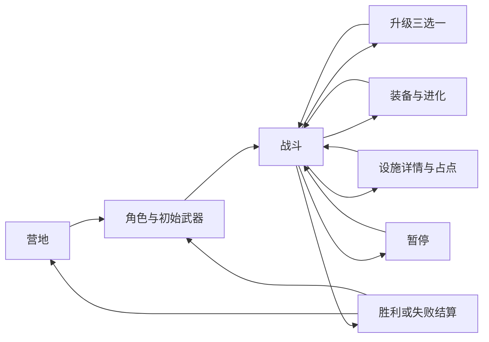

# 《星环余烬》界面设计 v0.3

当前更新：六名角色的概念/头像/单朝向透明战斗小图已接入网页，新增刺客墨刃；64/96px、灰度与武器搭配见 [v004 六人预览](../output/imagegen/characters-v004/index.html)。[战斗挂点与配件路线](CHARACTER_LOADOUTS.md) · [刺客机制](ASSASSIN_DESIGN.md)。历史 v001–v003 记录保留；Godot 六人机制、分层换装、多朝向动画仍待实现。

状态：v0.4 六人角色可交互原型与新版页面规格；新增两位现已使用已认可的 v001 概念图与 v002 同源头像、透明战斗静态首帧；原三位已更新 v003 绘画概念图与同源头像，v004 已补齐静态战斗稿，动画待制作。新增角色见 [角色设计](CHARACTER_DESIGN.md)。这里定义后续 Godot 界面的目标，不代表游戏已经接入全部系统。

- [打开本地 HTML 原型](../artifacts/ui/index.html)
- 本机预览地址：<http://127.0.0.1:8765/artifacts/ui/index.html>（当前本地服务运行时可用）。
- 玩法规则：[GAME_DESIGN.md](GAME_DESIGN.md)；整体视觉约束：[../DESIGN.md](../DESIGN.md)。

## 1. 界面目标与视觉方向

营地有探索氛围，战斗优先读懂危险，升级能比较收益，结算能解释本局。

视觉：苔绿遗迹、暖金机械、星光、低饱和角色斗篷；背景以旧式天文仪的同心环与刻度构图。避免普通应用仪表盘式布局，把场景、角色与 UI 放在同一个游戏世界里。

- 标题用宋体/衬线字，中文正文用苹方/微软雅黑，时间与数值用等宽字体。
- 主行动为暖金实底；次行动为深绿描边；薄荷绿表示经验、获得与满足条件；珊瑚红表示伤害、代价与危险。
- 面板采用直角或 2–4 像素小倒角、细金属边框，背景低透明但保证阅读。原型旧 UI 的大圆角不作为新视觉目标。
- 旧版角色概念剪影由原创 SVG 表达；新版按已认可的绘画风角色推进，霁月与螺灯已用真实生成 PNG 替换其旧 SVG，女性露出面部、机器人采用独立机械体块；场景由本地 Canvas 绘制。它们用于方向确认，不是最终精灵、动画或商业美术包。
- 不以高频闪烁、强烈震屏或满屏发光表达成长。敌人弹幕的可读性优先于友方技能特效。

## 2. 页面与流程

核心页面共七类；暂停、设置、营地核心、装备档案、放弃确认为辅助弹层。预览页顶部的七个标签是设计审阅导航，不进入最终游戏。

## 3. 营地

[营地设计图](../artifacts/ui/camp.png)

布局：左侧游戏标题、短叙事与主导航；右侧大角色剪影、观测站装置和本次目的地；底部放进度与档案状态。

主行动只有一个：**踏入遗迹**。其下依次为武器与进化档案、营地核心、声音与显示。首次默认焦点在出发按钮；未读解锁可以在相应入口显示小标记，避免开局连弹多个通知。

星砂、核心等级和上次探索属于次要信息，不与主行动争抢视觉。存档不可用时用明确提示替换“已就绪”，不能仍显示成功状态。

## 4. 角色与初始武器

[五人角色设计图：霁月](../artifacts/ui/roles-v03-jiyue.png) · [机器人](../artifacts/ui/roles-v03-luodeng.png) · [造型对照板](../artifacts/ui/characters/index.html)

新版左侧采用三列两行的六人头像卡，右侧展示所选大立绘与基础生命、移速、优势和代价，下方保留武器选择与出发按钮。六人包括女性星图师、机器人螺灯和刺客墨刃。

- 角色卡同时展示剪影、姓名、职业、打法关键词。
- 选中角色使用金色边框、底线与“已选择”文本，不仅换颜色。
- 切换角色默认选其推荐武器，玩家可再次改为任意已解锁武器。
- 显示基础生命，并告知核心加成出发时计算；避免把“角色强弱”和“存档等级”混在一起。
- 锁定角色仍能查看剪影与条件，出发按钮禁用并说明原因；不得把后续熔核行者混入首版选择。
- 现有 HTML 原型已加入五人选择、独立大图、头像、推荐武器及 HUD 展示。霁月与螺灯已替换为已认可概念图、同源裁切头像与生成的透明静态战斗稿；演示档案全部可选，不读取真实解锁或存档。

## 5. 战斗 HUD

[战斗设计图](../artifacts/ui/battle.png)

按 1440×900 参考画板分配：

| 区域 | 内容 | 呈现原则 |
|---|---|---|
| 左上约 30–375 × 25–115 | 头像、角色、等级、生命、击败数 | 生命数值与血条同时存在，掉血反馈短促 |
| 上方中央 | 当前时间、下一阶段 | Boss 前显示 09:00 预告；10:00 后改为最后一分钟倒计时 |
| 上边缘细条 | 经验进度 | 获得经验有轻微反馈，不覆盖敌弹 |
| 右上 | 装备、暂停、雷达 | 图标附按键提示；设施用不同形状标记 |
| 左侧次级目标区 | 当前目标、已选设施数 | 只放当前最重要目标，避免长任务列表 |
| 中央大区域 | 战斗与危险预警 | 至少保留约三分之二画面；中心不常驻菜单 |
| 左下 | 三武器＋四模块 | 武器显示等级/进化，模块显示等级；完整说明放图鉴 |
| 右下 | 冲刺可用性/冷却 | 同时用文字与充能条，不只用颜色 |
| 附近设施上方 | E 交互提示 | 显示“按住 E”“会占名额”，离远时收起 |

新增角色反馈：星图师对目标显示轮廓外的四段星痕标记；螺灯生命条下增加一条细湖蓝护盾条，显示护盾值。两者不新增主动技能键或大型资源面板。

屏幕边缘给出精英材料、已选设施和 Boss 的方向提示；屏外提示有优先级，不能铺满边框。

## 6. 升级三选一

[升级设计图](../artifacts/ui/upgrade.png)

全屏遮罩降低战场明度，顶部明确显示“战斗与计时已暂停”。三张等宽卡片从左到右对应数字 1、2、3。

每张卡内容顺序：类别 → 名称/图标 → 当前等级到下一等级 → 两项具体变化 → 与当前构筑的关系 → 按键。

例：星辉弹 Lv.5→6，显示“伤害 38→42，冷却 0.60→0.55 秒”，并提醒是否满足进化条件。不要仅写“史诗强化”“大幅提高”。

重抽作为次行动显示剩余次数。重抽后数字键必须跟随当前卡片位置；耗尽后禁用。三项不足时按玩法文档补给填位，不能有空卡或不可用卡。

卡片焦点默认在第一项，Tab/方向导航不进入被遮住的战场。每次选择只提交一次；鼠标与数字键并发不能连选两次升级。

## 7. 进化确认

[进化设计图](../artifacts/ui/evolve.png)

独立暂停弹层，用原武器→进化武器的图形变化表达质变。公开列出武器等级、模块等级、碎片数量与本局进化次数。

主按钮写“消耗碎片并进化”，次按钮写“稍后决定”。不满足时主按钮禁用并显示缺少条件，不能先扣材料再报错。已进化后装备槽位保留，新增碎弹或移动灯塔有明确形状变化。

进化入口在装备图鉴或 HUD 的“可进化”提示中出现；不在战斗危险时自动盖住画面。

## 8. 设施交互

[设施设计图](../artifacts/ui/facility.png)

战斗仍可继续，设施详情固定在右侧，不使用全屏模糊遮罩。主要信息是收益、守卫风险、名额、当前占点进度。

状态：未开放 → 可选定 → 长按选定 → 占点中/离圈暂停 → 已启用；另有名额已满状态。

- 正式游戏按住 E 0.6 秒确认；原型使用按钮点击演示状态，不模拟距离、长按、移动或敌人。
- 选定即占用名额；选择第二处后第三处禁用，显示原因。
- 普通角色需要累计 18 秒，织星匠 14.4 秒；进入暂停、离圈或升级不增加进度。
- 已启用后显示实际收益和下一次产出时间；温室储存满时显示“已储存 2/2”，而非继续倒计时。
- 设施详情关闭后回到战场，不意味着放弃已选择的设施。

原型把“停留设施页”视作圈内占点，离开页暂停进度，重新打开继续。它没有物理世界判定。

## 9. 结算

[结算设计图](../artifacts/ui/result.png)

左侧保留角色形象，右侧按结果、数据、构筑、奖励、下次行动排列。

胜利文案“星光长存”，失败文案“余烬未熄”。失败时给出具体死因与一条可行动建议，不写笼统的“你还不够强”。

- 显示生存时间、击败数、完成设施和关键进化。
- 星砂奖励给出时间/击败/设施/胜利来源；正常游戏结算只发一次。
- 主行动返回营地，次行动调整配置再出发。
- 新解锁在结算/营地集中展示一次，不用多个连续弹窗。
- 原型提供胜负切换供审阅；实际游戏不出现“切换状态预览”入口。

## 10. 辅助弹层

| 弹层 | 内容与操作 |
|---|---|
| 暂停 | 明确冻结范围，继续探索为主按钮；提供设置与放弃入口 |
| 放弃确认 | 说明本局不发奖励、不产生解锁，默认焦点为继续探索 |
| 声音与显示 | 音量数值、减少动效；设置即时反馈，Esc 可关闭 |
| 装备档案 | 进化配方和现有装备状态；战斗中打开必须冻结危险与计时 |
| 营地核心 | 当前等级、当前收益、下级收益、所需与持有星砂；资金不足/满级状态明确 |

弹层关闭后把焦点交回打开它的入口，不能把一次 Esc 同时传给两层界面。

## 11. 适配与输入

HTML 原型按 1440×900 参考画板等比缩放，以方便在浏览器审阅；这不是最终 Godot 的字号缩放实现。

Godot 当前逻辑尺寸 1120×760。落地时使用锚点/容器重新布置，保持正文 16–18 逻辑像素、按钮足够可点击，不能直接把 HTML 缩成小图。16:9/16:10 保持核心信息安全区，必要时加黑边，不横向拉伸角色或裁切 HUD。

正式键位：WASD 移动、空格冲刺、E 设施、Tab 装备/进化、1/2/3 选升级、P/Esc 暂停。HTML 原型实现页面按钮、1/2/3、P、Esc、Tab 装备等交互；WASD 与冲刺只有示意，不是可玩战斗。

键盘焦点有可见描边；模态弹层限制焦点范围；关键文字不依赖悬停才出现。减少动效关闭入场运动与过渡；图标、形状和文字补充颜色含义。

## 12. 原型范围与证据

实现的交互：七页切换、角色与推荐武器同步、手动换武器、升级与重抽、进化槽位替换、暂停/确认、两处设施名额、占点界面计时、核心购买、演示结算、设置控件。

限制：所有档案数据仅保存在本页内存，刷新重置；没有读取/写入 Godot 存档；战斗、掉落、真实随机升级、音频播放与伤害计算不在该原型实现。升级重抽演示备用排序，不代替正式加权随机池。各设计页可单独进入，演示数据不保证组成同一局完整录像。

已检查：早期版本有 19 项点击/键盘断言；本轮新增五人选择、素材加载、推荐武器、头像/HUD、护盾和角色方向键等 18 项断言通过；1440 宽与 1120 宽无横向溢出；七张页面截图；最终浏览器错误控制台为空。见 [原型验证记录](../artifacts/ui/VALIDATION.md)。

## 13. v002 角色资产接入

[资产预览](../output/imagegen/characters-v002/index.html) · [提示词与处理清单](../art/prompts/characters/v002/README.md)。两位新角色的缩略头像与 HUD 均指向同源裁切，角色选择大图指向已认可概念图，Canvas 战斗示例加载 96px 透明 PNG，保持比例显示。多朝向、动画与 Godot 实际机制不属于本次网页预览接入。

## 14. 战斗数字与暴击反馈

按 [COMBAT_DESIGN](COMBAT_DESIGN.md) 执行：普通伤害米白、暴击暖金＋小星符且字号约 1.2 倍、治疗绿色加号、护盾湖蓝。普通与暴击分别聚合，不能把普通伤害一起涂黄。默认不显示被无敌/命中间隔过滤的 0；调试原因不混入正式战斗画面。

星痕标记只是增伤状态，不保证暴击；装备图鉴显示“实际暴击率”“暴击伤害倍率”和聚光镜提供的百分点。首版不做每次暴击震屏或全局停顿；敌方危险边界始终高于友方范围特效。以上是待实现 UI 合同，当前网页数字示例不代表实际运行了新伤害系统。

## 15. 武器升级与配件维护

[武器定制](WEAPON_CUSTOMIZATION.md) 为维护界面的规则来源。左侧三武器和局部槽，中间可用配件，右侧当前→安装后参数与代价；确认、取消和领取维修包分开。每件武器一个局部槽，不与四个全局模块混为一排。只有两件合法配件时显示两件＋维修，不伪造第三件。替换明确告知旧配件移除不保留。

维修打开后暂停战斗；关闭不消费，确认才提交。HUD 只增加一个小插槽标记；Tab 显示完整详情。当前网页原型尚未实现该维护页，不能把旧装备图鉴当作装配已完成。

新增五人美术统一预览：[v003 概念图与头像](../output/imagegen/characters-v003/index.html)。原三位新稿待确认；选择页已替换，不能把原三位战斗画面的旧占位当作已完成新精灵。
